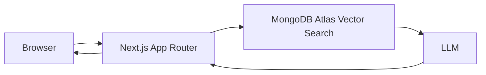

# TripCraft

TripCraft is an AI trip planner for building day-by-day itineraries from a short trip brief. The current repo is an early Next.js App Router scaffold; the full planner described here is the target product, with many of the trip-planning features still planned.

[](https://nextjs.org/)
[](https://www.typescriptlang.org/)
[](https://www.mongodb.com/cloud/atlas)
[](https://vercel.com/)

## Live demo

- Demo: <DEMO_URL>
- Example share page: <EXAMPLE_SHARE_URL>

## Screenshots

- Trip form: <ADD_SCREENSHOT_URL>
- Itinerary view: <ADD_SCREENSHOT_URL>
- Chat editing: <ADD_SCREENSHOT_URL>
- Share page: <ADD_SCREENSHOT_URL>

## Current status

This repository is an early TripCraft implementation. It includes Google OAuth-protected API routes for generating and editing saved itineraries. The trip-planning UI and account-management experience are still planned.

## Features

Implemented today:

- Next.js App Router project scaffold
- TypeScript setup
- Base styling and layout from the default app template
- MongoDB client, collection setup, and indexes
- Seed script with five destinations and six guide-text chunks per destination; embeddings are optional
- Google OAuth sessions with Auth.js
- `POST /api/trips/generate` creates a saved trip and day-by-day itinerary for the signed-in user
- `POST /api/trips/[id]/chat` revises one saved day, using fresh guide retrieval and appending the exchange to trip chat history

Planned:
- Trip brief form for dates, cities, interests, and budget
- User-facing sign-in and saved-trip UI
- Public share pages for finished itineraries

## How TripCraft works

1. RAG-grounded planning
   
   TripCraft is designed to ground itinerary generation in destination guide content stored in MongoDB Atlas. The content is chunked, embedded, and indexed for vector search. When a user describes a trip, the system retrieves the relevant passages and asks the LLM to build the itinerary from that source material instead of inventing destinations or activities.

   Destination guide content, retrieval, and itinerary generation are implemented. An authenticated request to `POST /api/trips/generate` accepts a `brief` containing `cities`, `startDate`, `endDate`, `interests`, `budget`, and optional `notes`. It stores the generated trip and day documents under the signed-in user's ID.

2. Conversational editing
   
   `POST /api/trips/[id]/chat` accepts a `dayNumber` and an `instruction`. It loads only that itinerary day, retrieves fresh guide chunks, and asks the model for a schema-validated revision. The day update and the two chat-history entries are saved in one MongoDB transaction, so neither persists if the other fails.

   A user-facing chat editor is still planned.

3. Accounts and sharing
   
   Auth.js Google OAuth protects trip generation and editing APIs, and generated trips are stored per authenticated user. A user-facing account experience and public read-only share pages are still planned.

   Sign in through Auth.js at `/api/auth/signin`.

## Architecture

The project is intended to split responsibilities cleanly:

- Server Components fetch trip data and render shared/public pages
- Client Components handle the trip form, itinerary UI, and chat editor
- Route Handlers handle authenticated trip generation and day-level itinerary edits

The generation, chat-edit, and Auth.js handlers are implemented; the client trip-planning UI and share routes are still planned.



## Why Next.js instead of a plain React SPA

Next.js is a better fit for TripCraft than a standalone React app because it can render shareable pages on the server and provide metadata for social previews without a separate backend service. A single app can handle both the authenticated trip planner experience and public links such as /share/[slug], which is easier to deploy and maintain than splitting front-end and API concerns across different repositories or runtimes.

Planned: this repo is still in the early scaffolding stage.

## Tech stack

| Layer | Current repo state | Planned / target |
| --- | --- | --- |
| Framework | Next.js 16 App Router | Next.js App Router |
| UI | React 19 | React 19 |
| Language | TypeScript | TypeScript |
| Styling | Base CSS and default Next app styles | Tailwind or design system |
| Database | MongoDB client and collections | MongoDB Atlas |
| Search | Vector retrieval implemented | Atlas Vector Search |
| LLM | Gemini through the Vercel AI SDK | Gemini |
| Auth | Google OAuth for API routes | Auth.js |
| Deployment | Local Next.js app | Vercel |

## Getting started

### Prerequisites

- Node.js 20+
- npm
- A MongoDB Atlas replica-set deployment (transactions are used when saving trips and chat edits)
- A Google AI Studio API key for Gemini
- A Google OAuth client for Auth.js
- A Vercel account for deployment

### Clone and install

```bash
git clone https://github.com/imran2522/Tripcarft.git
cd Tripcarft
npm install
```

### Environment variables

Copy `.env.example` to `.env.local` and set the MongoDB, Google AI, and Auth.js values. Choose a currently available chat model in Google AI Studio for `GEMINI_CHAT_MODEL`.

```bash
cp .env.example .env.local
```

Notes:

- `MONGODB_URI` is required to seed the database; `MONGODB_DB` defaults to `tripcraft`.
- Without `GOOGLE_GENERATIVE_AI_API_KEY`, the seed script stores guide text without embeddings. To generate embeddings, set `GOOGLE_GENERATIVE_AI_API_KEY`, `EMBEDDING_MODEL`, and `EMBEDDING_DIMENSIONS`.
- `AUTH_SECRET` should be a unique random secret; generate one with `openssl rand -base64 32`.
- Set `AUTH_GOOGLE_ID` and `AUTH_GOOGLE_SECRET` from a Google OAuth client. Register `http://localhost:3000/api/auth/callback/google` as a development redirect URI and the corresponding production URL when deploying. These OAuth credentials are separate from the Google AI API key.
- The API routes require an active Google sign-in session. Auth.js provides a default sign-in page at `/api/auth/signin`; there is not yet a sign-in UI in the app.

### API endpoints

Sign in at `/api/auth/signin`, then send requests with the resulting session cookies.

Generate and persist a trip; start/end dates are inclusive, and `cities` must match seeded destination slugs or names:

```json
{
  "brief": {
    "cities": ["Istanbul"],
    "startDate": "2027-05-10",
    "endDate": "2027-05-12",
    "interests": ["food", "history"],
    "budget": "mid",
    "notes": "Keep the pace relaxed."
  }
}
```

`POST /api/trips/generate` responds with `tripId` and generated `days`. Use that ID to revise a single day:

```json
{
  "dayNumber": 2,
  "instruction": "Swap the afternoon activity for a slower neighborhood walk."
}
```

Send this body to `POST /api/trips/{tripId}/chat`. The route verifies ownership and returns the revised day. Both routes set a 60-second execution limit for retrieval and model generation.

### Seed command

Run the seed script with:

```bash
npm run seed
```

The script upserts five destinations (Istanbul, Cappadocia, Lisbon, Kyoto, and Cairo), each with six guide-text chunks, plus an example Istanbul trip and its three itinerary days. It is safe to rerun. To generate embeddings, configure the embedding variables above before running it.

**Destructive:** `npm run seed -- --reset` drops the `destinations`, `trips`, and `itineraryDays` collections before recreating them. This deletes all data in those collections.

### Create the Atlas Vector Search index

This index definition is a planned example for the TripCraft data model. Update the `path`, `numDimensions`, and `similarity` values to match your embedding model and collection.

```json
{
  "fields": [
    {
      "type": "vector",
      "path": "embedding",
      "numDimensions": 1536,
      "similarity": "cosine"
    },
    {
      "type": "filter",
      "path": "destination"
    },
    {
      "type": "filter",
      "path": "language"
    }
  ]
}
```

Create this index in Atlas using the collection that stores destination guide chunks.

### Run the app

```bash
npm run dev
```

Then open http://localhost:3000.

## Deployment

### Vercel

Deploy the app to Vercel using the standard Next.js setup. Add the environment variables from the section above in the project settings and keep them separate for development and production. Add the production Auth.js callback URL, `https://<your-domain>/api/auth/callback/google`, to the Google OAuth client.

### Atlas network access

For MongoDB Atlas, allow access from Vercel and local development IPs. A common setup is:

- Network access: 0.0.0.0/0 (for Vercel serverless or ephemeral environments)
- Database user: dedicated to this project
- Password: strong, unique, and stored only in environment variables or Vercel secrets

### Limits

- The current repo does not yet include a working production deployment configuration.
- Atlas free-tier or paused clusters can cause cold starts or intermittent availability.
- Vercel Hobby is not intended for commercial use.

## Limitations and scope

- This repository is currently a starter app, not a production-ready trip planner.
- It only supports destinations included in the seed data.
- There is no booking flow, live price data, or real-time availability integration.
- No live travel APIs are connected yet.
- Planned later: only a curated set of destinations, with no claim of real-time travel correctness.
- Free-tier or paused database plans may experience cold starts or delayed responses.
- Vercel Hobby is a non-commercial plan and is not a replacement for a production platform.

## Roadmap / future ideas

Planned next steps:

- Build the client-side trip form and itinerary experience
- Add user-facing saved trip history and sign-in UI
- Implement share pages with metadata previews
- Add a real flight-data or hotel-data provider later, if needed
- Expand destination coverage and trip styles

## License

No license has been added to this repository yet. If you plan to release it publicly, choose a standard open-source license such as MIT and add a LICENSE file before publishing.

## Placeholder items to fill in

The following items are intentionally left as placeholders for the real project:

- Demo URL: <DEMO_URL>
- Example share page: <EXAMPLE_SHARE_URL>
- Trip form screenshot: <ADD_SCREENSHOT_URL>
- Itinerary view screenshot: <ADD_SCREENSHOT_URL>
- Chat editing screenshot: <ADD_SCREENSHOT_URL>
- Share page screenshot: <ADD_SCREENSHOT_URL>
- Real Atlas vector index configuration: pending project implementation
- Production deployment URL: to be added once deployed
- License choice: pending
