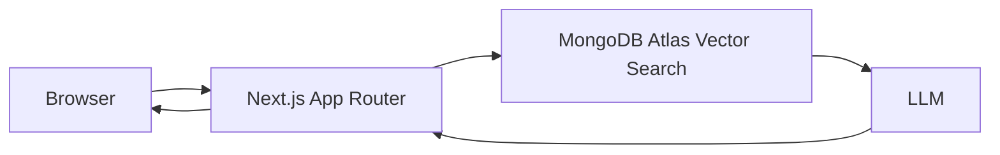

# TripCraft

TripCraft is an AI trip planner for building day-by-day itineraries from a short trip brief. The current repo is an early Next.js App Router scaffold; the full planner described here is the target product, with many of the trip-planning features still planned.

[](https://nextjs.org/)
[](https://www.typescriptlang.org/)
[](https://www.mongodb.com/cloud/atlas)
[](https://vercel.com/)

## Live demo

- Demo: <DEMO_URL>
- Example share page: <EXAMPLE_SHARE_URL>

## Screenshots

- Trip form: <ADD_SCREENSHOT_URL>
- Itinerary view: <ADD_SCREENSHOT_URL>
- Chat editing: <ADD_SCREENSHOT_URL>
- Share page: <ADD_SCREENSHOT_URL>

## Current status

This repository is an early TripCraft implementation. It includes a MongoDB data layer, seed data, and an API endpoint for generating itineraries; the trip-planning UI and account features are still planned.

## Features

Implemented today:

- Next.js App Router project scaffold
- TypeScript setup
- Base styling and layout from the default app template
- MongoDB client, collection setup, and indexes
- Seed script with five destinations and six guide-text chunks per destination; embeddings are optional
- `POST /api/trips/generate` accepts a JSON `{ "brief": { ... } }` payload and returns generated itinerary items

Planned:
- Trip brief form for dates, cities, interests, and budget
- Follow-up chat editing for itinerary updates
- Saved trips per user
- Public share pages for finished itineraries
- MongoDB Atlas vector search and embeddings pipeline

## How TripCraft works

1. RAG-grounded planning
   
   TripCraft is designed to ground itinerary generation in destination guide content stored in MongoDB Atlas. The content is chunked, embedded, and indexed for vector search. When a user describes a trip, the system retrieves the relevant passages and asks the LLM to build the itinerary from that source material instead of inventing destinations or activities.

   Destination guide content, retrieval, and itinerary generation are implemented. Send a `brief` containing `cities`, `startDate`, `endDate`, `interests`, `budget`, and optional `notes` to `POST /api/trips/generate`. The route uses Next.js's default Node.js runtime because Cache Components are enabled.

2. Conversational editing
   
   After the initial itinerary is created, the user can ask to change specific days or swap activities. The app is intended to update the saved itinerary rather than regenerate the whole trip from scratch, preserving trip context across follow-up chat messages.

   Planned: this is not implemented in the current repo snapshot.

3. Accounts and sharing
   
   Trips are intended to be saved per authenticated user with Auth.js. A public read-only route such as /share/[slug] is meant to expose a trip snapshot that renders metadata and social preview information for links shared on WhatsApp, LinkedIn, and similar platforms.

   Planned: this is not implemented in the current repo snapshot.

## Architecture

The project is intended to split responsibilities cleanly:

- Server Components fetch trip data and render shared/public pages
- Client Components handle the trip form, itinerary UI, and chat editor
- Route Handlers handle streaming AI responses and itinerary updates

The generation Route Handler is implemented; the client trip-planning UI, saved-trip flow, and remaining route handlers are still planned.



## Why Next.js instead of a plain React SPA

Next.js is a better fit for TripCraft than a standalone React app because it can render shareable pages on the server and provide metadata for social previews without a separate backend service. A single app can handle both the authenticated trip planner experience and public links such as /share/[slug], which is easier to deploy and maintain than splitting front-end and API concerns across different repositories or runtimes.

Planned: this repo is still in the early scaffolding stage.

## Tech stack

| Layer | Current repo state | Planned / target |
| --- | --- | --- |
| Framework | Next.js 16 App Router | Next.js App Router |
| UI | React 19 | React 19 |
| Language | TypeScript | TypeScript |
| Styling | Base CSS and default Next app styles | Tailwind or design system |
| Database | Not configured | MongoDB Atlas |
| Search | Not configured | Atlas Vector Search |
| LLM | Not configured | Gemini via the Vercel AI SDK |
| Auth | Not configured | Auth.js |
| Deployment | Local Next.js app | Vercel |

## Getting started

### Prerequisites

- Node.js 20+
- npm
- A MongoDB Atlas account for the planned vector-search setup
- A Google AI Studio API key for Gemini
- A Vercel account for deployment

### Clone and install

```bash
git clone https://github.com/imran2522/Tripcarft.git
cd Tripcarft
npm install
```

### Environment variables

Copy `.env.example` to `.env.local` and set the MongoDB connection string and Google Generative AI API key. Choose a currently free chat model in Google AI Studio for `GEMINI_CHAT_MODEL`. Embedding settings are needed only when generating vector embeddings during seeding.

```bash
cp .env.example .env.local
```

Notes:

- `MONGODB_URI` is required to seed the database; `MONGODB_DB` defaults to `tripcraft`.
- Without `GOOGLE_GENERATIVE_AI_API_KEY`, the seed script stores guide text without embeddings. To generate embeddings, set `GOOGLE_GENERATIVE_AI_API_KEY`, `EMBEDDING_MODEL`, and `EMBEDDING_DIMENSIONS`.

### Seed command

Run the seed script with:

```bash
npm run seed
```

The script upserts five destinations (Istanbul, Cappadocia, Lisbon, Kyoto, and Cairo), each with six guide-text chunks, plus an example Istanbul trip and its three itinerary days. It is safe to rerun. To generate embeddings, configure the embedding variables above before running it.

**Destructive:** `npm run seed -- --reset` drops the `destinations`, `trips`, and `itineraryDays` collections before recreating them. This deletes all data in those collections.

### Create the Atlas Vector Search index

This index definition is a planned example for the TripCraft data model. Update the `path`, `numDimensions`, and `similarity` values to match your embedding model and collection.

```json
{
  "fields": [
    {
      "type": "vector",
      "path": "embedding",
      "numDimensions": 1536,
      "similarity": "cosine"
    },
    {
      "type": "filter",
      "path": "destination"
    },
    {
      "type": "filter",
      "path": "language"
    }
  ]
}
```

Create this index in Atlas using the collection that stores destination guide chunks.

### Run the app

```bash
npm run dev
```

Then open http://localhost:3000.

## Deployment

### Vercel

Deploy the app to Vercel using the standard Next.js setup. Add the environment variables from the section above in the project settings and keep them separate for development and production.

### Atlas network access

For MongoDB Atlas, allow access from Vercel and local development IPs. A common setup is:

- Network access: 0.0.0.0/0 (for Vercel serverless or ephemeral environments)
- Database user: dedicated to this project
- Password: strong, unique, and stored only in environment variables or Vercel secrets

### Limits

- The current repo does not yet include a working production deployment configuration.
- Atlas free-tier or paused clusters can cause cold starts or intermittent availability.
- Vercel Hobby is not intended for commercial use.

## Limitations and scope

- This repository is currently a starter app, not a production-ready trip planner.
- Destination data is not yet seeded or curated.
- There is no booking flow, live price data, or real-time availability integration.
- No live travel APIs are connected yet.
- Planned later: only a curated set of destinations, with no claim of real-time travel correctness.
- Free-tier or paused database plans may experience cold starts or delayed responses.
- Vercel Hobby is a non-commercial plan and is not a replacement for a production platform.

## Roadmap / future ideas

Planned next steps:

- Add destination seed data and embedding pipeline
- Build trip form and itinerary generation flow
- Add saved trip history and Auth.js integration
- Implement share pages with metadata previews
- Add chat-based itinerary editing with streaming responses
- Add a real flight-data or hotel-data provider later, if needed
- Expand destination coverage and trip styles

## License

No license has been added to this repository yet. If you plan to release it publicly, choose a standard open-source license such as MIT and add a LICENSE file before publishing.

## Placeholder items to fill in

The following items are intentionally left as placeholders for the real project:

- Demo URL: <DEMO_URL>
- Example share page: <EXAMPLE_SHARE_URL>
- Trip form screenshot: <ADD_SCREENSHOT_URL>
- Itinerary view screenshot: <ADD_SCREENSHOT_URL>
- Chat editing screenshot: <ADD_SCREENSHOT_URL>
- Share page screenshot: <ADD_SCREENSHOT_URL>
- .env.example file: not present yet
- Seed command: planned, not implemented
- Real Atlas vector index configuration: pending project implementation
- Production deployment URL: to be added once deployed
- License choice: pending
